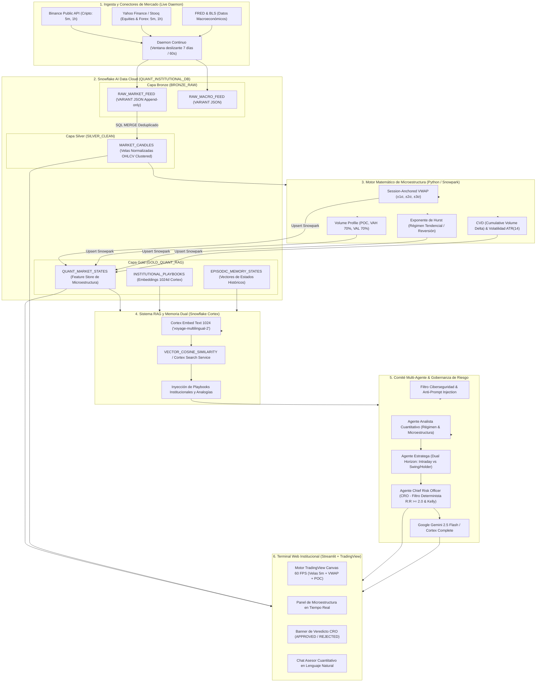
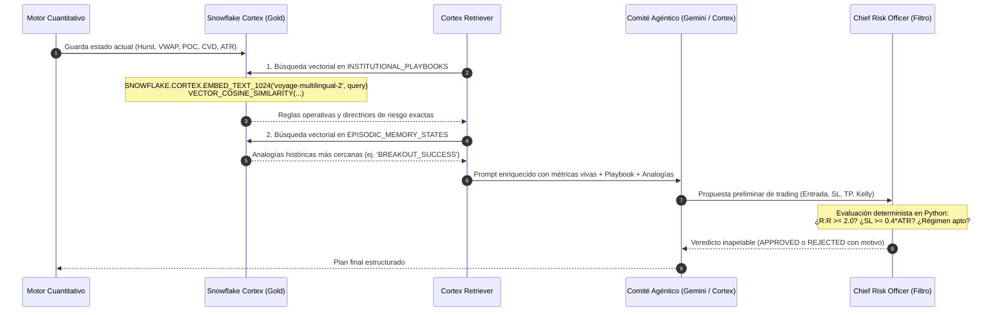

# | Institutional Multi-Market Terminal & Multi-Agent Committee

> **Plataforma Cuantitativa y Agéntica de Grado Institucional (Hedge Funds)** integrada nativamente con **Snowflake AI Data Cloud**, arquitectura Medallion (**Bronze, Silver, Gold**), cálculo de microestructura de mercado en tiempo real (**Velas de 5m/1h, VWAP Bands, Volume Profile POC/VAH/VAL, Hurst, CVD**) y orquestación multi-agente con filtro determinista del **Chief Risk Officer (CRO)**.

---

## 📑 Tabla de Contenidos

1. [🏛️ Arquitectura General del Sistema](#️-arquitectura-general-del-sistema)
2. [❄️ Snowflake AI Data Cloud: Rol y Arquitectura Medallion](#️-snowflake-ai-data-cloud-rol-y-arquitectura-medallion)
3. [🧠 El Motor RAG (Retrieval-Augmented Generation) y Memoria Episódica](#-el-motor-rag-retrieval-augmented-generation-y-memoria-episódica)
4. [🔄 Flujo de Datos y Lógica Cuantitativa Integral](#-flujo-de-datos-y-lógica-cuantitativa-integral)
5. [🛡️ Comité Multi-Agente y Filtro de Riesgo (CRO Guardrails)](#️-comité-multi-agente-y-filtro-de-riesgo-cro-guardrails)
6. [🖥️ Frontend y Terminal Interactivo](#️-frontend-y-terminal-interactivo)
7. [🚀 Guía de Instalación y Puesta en Marcha](#-guía-de-instalación-y-puesta-en-marcha)
8. [📁 Estructura del Repositorio](#-estructura-del-repositorio)

---

## 🏛️ Arquitectura General del Sistema

QUANT CORTEX desacopla la ingesta masiva de datos de mercado, el cómputo cuantitativo de microestructura, el almacenamiento vectorial y la deliberación agéntica. Todo converge sobre **Snowflake AI Data Cloud** como núcleo transaccional y analítico.



---

## ❄️ Snowflake AI Data Cloud: Rol y Arquitectura Medallion

Snowflake actúa como el **almacén central unificado de datos, cómputo y vectores**, eliminando la necesidad de bases de datos de series de tiempo separadas o motores vectoriales independientes.

### 1. Ventajas de la Arquitectura en Snowflake

* **Separación de Almacenamiento y Cómputo:**
  - `INGEST_WH` (Virtual Warehouse talla `XSMALL`, auto-suspend 60s): Dedicado exclusivamente a la ingesta no bloqueante de datos crudos y transacciones de carga.
  - `QUANT_RAG_WH` (Virtual Warehouse talla `SMALL`, auto-suspend 120s): Dedicado al cálculo intensivo de microestructura en Snowpark y a las consultas vectoriales de similitud coseno.
* **Cómputo en el Dato (In-Database Computation):**
  Las transformaciones analíticas y la generación de embeddings suceden dentro del motor optimizado de Snowflake mediante Snowpark y Cortex, evitando transferir millones de registros a memoria local.
* **Transaccionalidad ACID e Idempotencia:**
  Uso de sentencias `MERGE` (Upsert) que garantizan que el pipeline pueda reanudarse o duplicarse sin generar duplicados de velas ni corromper las series temporales.

### 2. Capas Medallion Implementadas

| Capa             | Esquema            | Tablas Principales                                                     | Rol Técnico en el Proyecto                                                                                                                                                                                                                    |
| :--------------- | :----------------- | :--------------------------------------------------------------------- | :--------------------------------------------------------------------------------------------------------------------------------------------------------------------------------------------------------------------------------------------- |
| **Bronze** | `BRONZE_RAW`     | `RAW_MARKET_FEEDRAW_ORDERBOOK_FEED``RAW_MACRO_FEEDRAW_NEWS_FEED`     | Ingesta cruda append-only en columnas nativas `VARIANT` (JSON auditables). Preserva la trazabilidad completa desde la fuente sin esquemas rígidos.                                                                                          |
| **Silver** | `SILVER_CLEAN`   | `MARKET_CANDLES`                                                     | Series temporales limpias, validadas y normalizadas (Open, High, Low, Close, Volume). Posee clave primaria compuesta `(MARKET, TICKER, TIMEFRAME, TIMESTAMP_UTC)` y directiva `CLUSTER BY` para acelerar lecturas por intervalo de tiempo. |
| **Gold**   | `GOLD_QUANT_RAG` | `QUANT_MARKET_STATESINSTITUTIONAL_PLAYBOOKS``EPISODIC_MEMORY_STATES` | **Feature Store Cuantitativo y Base de Vectores.** Contiene métricas de microestructura calculadas por vela, así como vectores de 1024 dimensiones generados nativamente para el RAG.                                                  |

---

## 🧠 El Motor RAG (Retrieval-Augmented Generation) y Memoria Episódica

El módulo RAG garantiza que los agentes **no deliren (alucinen)** y formulen planes basados estrictamente en:

1. **Reglas institucionales codificadas** (Playbooks).
2. **Precedentes históricos reales** bajo condiciones matemáticas idénticas (Memoria Episódica).



### Componentes del Sistema RAG

#### A. Playbooks Institucionales Semánticos (`INSTITUTIONAL_PLAYBOOKS`)

Documentos de alta fidelidad redactados por analistas cuantitativos en `/playbooks`:

* `01_microestructura_liquidez.md`: Reglas de barridos de liquidez (*liquidity sweeps*), rechazos en bandas de VWAP $\pm 2\sigma / \pm 3\sigma$ y divergencias de CVD.
* `02_macro_carry_trade_forex.md`: Estrategias de Carry Trade, diferenciales de tipos de interés, límites de VIX (< 20) y decodificación de informes semanales COT (CFTC).
* `03_onchain_ciclos_cripto.md`: Ciclos On-Chain de Bitcoin, métricas MVRV Z-Score, reservas en exchanges y dinámicas de liquidaciones en derivados.

**Proceso de Ingesta Vectorial:**
El script `src/rag/ingest_playbooks_snow.py` particiona los playbooks en *chunks* contextuales y genera representaciones vectoriales densas utilizando el modelo multilingüe de Snowflake Cortex:

```sql
SNOWFLAKE.CORTEX.EMBED_TEXT_1024('voyage-multilingual-2', chunk_text)
```

#### B. Memoria Episódica de Mercado (`EPISODIC_MEMORY_STATES`)

A diferencia de los LLMs tradicionales que carecen de noción de mercado pasado, QUANT CORTEX archiva cada configuración cuantitativa relevante como un "episodio":

* **Vectorización:** Convierte el resumen textual del estado (`"BTCUSDT en MEAN_REVERSION con Hurst=0.41 y precio en banda inferior VWAP"`) en un vector de 1024 dimensiones.
* **Recuperación por Similitud:** Cuando el agente analiza el mercado hoy, ejecuta:

  ```sql
  SELECT TICKER, REGIME, OUTCOME_LABEL,
         VECTOR_COSINE_SIMILARITY(STATE_VECTOR, SNOWFLAKE.CORTEX.EMBED_TEXT_1024('voyage-multilingual-2', :current_state)) AS SIMILARITY_SCORE
  FROM GOLD_QUANT_RAG.EPISODIC_MEMORY_STATES
  ORDER BY SIMILARITY_SCORE DESC
  LIMIT 3;
  ```

  Esto permite al comité conocer si situaciones similares en el pasado culminaron en rupturas falsas o en rebotes efectivos.

---

## 🔄 Flujo de Datos y Lógica Cuantitativa Integral

### 1. Modelado Matemático de Microestructura

El motor cuantitativo implementado en `src/quant_engine/` procesa las velas de la capa Silver y produce los siguientes indicadores:

#### Exponente de Hurst ($H$) y Clasificación de Régimen

Calculado mediante el análisis de Rango Reescalado ($R/S$):

$$
E\left[\frac{R(n)}{S(n)}\right] = C \cdot n^H \quad \implies \quad \log\left(\frac{R}{S}\right) = \log(C) + H \cdot \log(n)
$$

* **$H < 0.45$ $\rightarrow$ Antipersistencia (`MEAN_REVERSION`):** El precio oscila y tiende a regresar al valor medio (estrategia de reversión a la media).
* **$0.45 \le H \le 0.55$ $\rightarrow$ Movimiento Browniano (`RANDOM_WALK`):** Ruido aleatorio sin memoria estadística. Se prohíben operaciones directas intradía.
* **$H > 0.55$ $\rightarrow$ Persistencia (`TRENDING_MOMENTUM`):** Rupturas continuadas en la misma dirección (estrategias de tendencia).

#### VWAP Anclado a Sesión y Bandas de Desviación Estándar

$$
\text{VWAP} = \frac{\sum_{i} P_{\text{typical}, i} \cdot V_i}{\sum_i V_i}, \quad P_{\text{typical}} = \frac{High + Low + Close}{3}
$$

$$
\sigma = \sqrt{\frac{\sum_i V_i \cdot (P_{\text{typical}, i} - \text{VWAP})^2}{\sum_i V_i}}
$$

* Bandas de intervención: $\text{VWAP} \pm 1\sigma$, $\text{VWAP} \pm 2\sigma$, $\text{VWAP} \pm 3\sigma$.

#### Perfil de Volumen (Volume Profile) y Value Area

Agrupa el volumen negociado en intervalos de precio discretos (*price bins*):

* **Point of Control (POC):** El nivel de precio exacto donde se acumuló el mayor volumen durante la ventana.
* **Value Area (VA):** Rango de precios que concentra el **70% del volumen total**.
  - **Value Area High (VAH):** Límite superior del 70%.
  - **Value Area Low (VAL):** Límite inferior del 70%.

#### Delta Acumulado de Volumen (CVD - Cumulative Volume Delta)

Mide la presión neta compradora frente a vendedora en las velas analizadas:

$$
\text{CVD}_t = \text{CVD}_{t-1} + (V_{\text{buyer}} - V_{\text{seller}})
$$

---

## 🛡️ Comité Multi-Agente y Filtro de Riesgo (CRO Guardrails)

El sistema opera con tres agentes especializados y un filtro ineludible de ciberseguridad y riesgo financiero:

### 1. Filtro de Ciberseguridad y Guardrails (`src/agents/security.py`)

* **Detección Anti-Prompt Injection:** Bloquea de forma heurística intentos de jailbreak (patrones DAN, `"ignore previous instructions"`, intentos de extracción de claves API o cadenas de conexión de Snowflake).
* **Filtro de Dominio Estricto:** Si la consulta del usuario se desvía del análisis financiero, microestructura o modelo de negocio, redirige respetuosamente la conversación.

### 2. Agente 1: Analista Cuantitativo de Microestructura

* Extrae el estado actual del Feature Store de Snowflake (`QUANT_MARKET_STATES`).
* Diagnostica el régimen de mercado vía Hurst y la posición del precio con respecto a VWAP, VAH y VAL.

### 3. Agente 2: Estratega Multi-Horizonte

* **Estrategia Intradía:** Plantea órdenes de entrada táctica en velas de 5m ancladas a rebotes en bandas de VWAP $\pm 2\sigma$ o barridos de liquidez cerca del POC.
* **Estrategia Swing / Holder:** Plantea asignaciones patrimoniales macro con base en tasas de interés, reportes COT y métricas On-Chain (MVRV).

### 4. Agente 3: Chief Risk Officer (CRO) — Filtro Determinista en Python

El CRO **no es un prompt ni un LLM vulnerable a manipulación**, sino una función de código Python (`evaluate_risk_officer_filter` en `src/agents/orchestrator.py`) que aplica reglas institucionales no negociables:

```python
# 1. Regla obligatoria de Ratio Beneficio / Riesgo
if strategy.reward_to_risk_ratio < 2.0:
    strategy.risk_officer_verdict = "REJECTED"
    strategy.action = "NO_TRADE"

# 2. Distancia mínima de Stop Loss por Ruido de Microestructura
if abs(strategy.entry_price - strategy.stop_loss_price) < (0.40 * atr):
    strategy.risk_officer_verdict = "REJECTED"
    strategy.action = "NO_TRADE"

# 3. Veto en Régimen de Caminata Aleatoria
if regime == "RANDOM_WALK" and strategy.horizon == "INTRADAY":
    strategy.risk_officer_verdict = "REJECTED"
    strategy.action = "NO_TRADE"
```

#### Asignación de Capital con Criterio de Kelly Fraccionado ($1/4$ Kelly)

El tamaño de posición óptimo se calcula mediante:

$$
f^* = \frac{p \cdot b - q}{b}
$$

Donde $p$ es la tasa de acierto estimada, $q = 1 - p$, y $b$ es la relación beneficio/riesgo. Para proteger la cartera contra rachas desfavorables, se utiliza una fracción conservadora:

$$
\text{Tamaño Posición} = \frac{1}{4} f^* \times \text{Capital Total} \quad (\text{máx. 1% a 2% de riesgo})
$$

---

## 🖥️ Frontend y Terminal Interactivo

El frontend en `app.py` integra tecnologías de vanguardia para brindar una experiencia fluida:

* **TradingView Lightweight Charts™ (Canvas HTML5 a 60 FPS):**
  - Renderizado directo acelerado por hardware sin lentitud ni re-cargas innecesarias.
  - Soporte completo para navegación táctil/ratón: rueda para zoom temporal, arrastre elástico vertical del eje de precios (*price scale drag*), y auto-escala del eje Y en tiempo real.
  - Marcadores de niveles institucionales: línea morada para **VWAP** y línea dorada para **POC**, con etiquetas de precio automáticas en el eje vertical.
  - Histograma de volumen integrado en el 18% inferior con opacidad balanceada.
* **Tarjetas KPI de Microestructura en Tiempo Real:** Exponente de Hurst, régimen clasificado, ATR actual y CVD acumulado.
* **Panel de Veredicto del CRO:** Tarjeta destacada verde (`APPROVED`) o roja (`REJECTED`) con la justificación técnica del veto.
* **Explorador Medallion:** Visualizador directo de registros en Bronze, Silver y Gold en Snowflake.
* **Chat Agéntico Institucional:** Interfaz conversacional con Gemini 2.5 Flash alimentado con el contexto RAG enriquecido.

---

## 🚀 Guía de Instalación y Puesta en Marcha

### Prerrequisitos

* Python 3.10 o superior (ej. Python 3.12 / 3.14).
* Cuenta en **Snowflake AI Data Cloud** con permisos para crear base de datos y esquemas.
* Clave de API de Google Gemini (`GEMINI_API_KEY`).

### 1. Clonar el Repositorio y Crear el Entorno Virtual

```bash
git clone https://github.com/tu-usuario/proyecto_agente_financiero.git
cd proyecto_agente_financiero

# Crear y activar entorno virtual
python3 -m venv .venv
source .venv/bin/activate
```

### 2. Instalar Dependencias

```bash
pip install --upgrade pip
pip install -r requirements.txt streamlit plotly
```

### 3. Configurar Variables de Entorno (`.env`)

Copia la plantilla y configura tus credenciales:

```bash
cp .env.example .env
```

Edita `.env` con tus parámetros reales:

```ini
# Snowflake AI Data Cloud
SNOWFLAKE_ACCOUNT="MI_ORGANIZACION-MI_CUENTA"
SNOWFLAKE_USER="MI_USUARIO"
SNOWFLAKE_PASSWORD="MI_PASSWORD"
SNOWFLAKE_AUTHENTICATOR="snowflake"
SNOWFLAKE_ROLE="ACCOUNTADMIN"
SNOWFLAKE_WAREHOUSE="COMPUTE_WH"
SNOWFLAKE_DATABASE="QUANT_INSTITUTIONAL_DB"
SNOWFLAKE_SCHEMA="GOLD_QUANT_RAG"

# Google Gemini API Key
GEMINI_API_KEY="AIzaSy..."
```

### 4. Inicializar Base de Datos y Vectores en Snowflake

Ejecuta los scripts SQL contenidos en `/snowflake_sql` en tu consola Snowflake (Snowsight) o mediante SnowSQL en este orden:

1. `snowflake_sql/01_setup_warehouses_db.sql`: Crea la base de datos `QUANT_INSTITUTIONAL_DB`, los esquemas (`BRONZE_RAW`, `SILVER_CLEAN`, `GOLD_QUANT_RAG`) y los *Warehouses*.
2. `snowflake_sql/02_tables_and_vectors.sql`: Crea las tablas Bronze, Silver y las tablas vectoriales con tipo `VECTOR(FLOAT, 1024)`.
3. `snowflake_sql/03_cortex_search_service.sql`: Habilita el servicio de búsqueda híbrida Cortex.

### 5. Ingestar los Playbooks Institucionales en Snowflake

Para vectorizar los playbooks y cargarlos en `GOLD_QUANT_RAG.INSTITUTIONAL_PLAYBOOKS`:

```bash
python -m src.rag.ingest_playbooks_snow
```

### 6. Iniciar el Terminal Web

Ejecuta el script de inicio optimizado:

```bash
./start_terminal.sh
```

O directamente con Streamlit:

```bash
streamlit run app.py --server.port 8501
```

Abre tu navegador en: **`http://localhost:8501`**

### 7. Ejecutar el Daemon en Segundo Plano (Opcional)

Para sincronizar automáticamente cada 60 segundos una ventana deslizante de 7 días con velas de 5 minutos y 1 hora:

```bash
python -m src.pipeline.live_daemon --interval 60 --days 7 --timeframe 5m
```

### 8. Streaming de Velas en Tiempo Real con Kafka & WebSocket (Sub-segundo)

Para ver las velas subir y bajar en tiempo real a 60 FPS directamente en el gráfico de TradingView:

1. **(Opcional) Levantar Clúster Kafka / Redpanda**:
   ```bash
   docker compose -f docker-compose.kafka.yml up -d
   ```
   *Acceso a Consola Web Redpanda:* `http://localhost:8080`

2. **Lanzar el Gateway de Streaming WebSocket**:
   ```bash
   # En Windows PowerShell:
   .\start_stream_gateway.ps1
   # O en terminal Python:
   python -m src.pipeline.ws_gateway
   ```

3. El frontend de TradingView se conectará automáticamente al puerto `8765`, encendiendo la insignia verde `LIVE STREAM` y actualizando en tiempo real la vela actual con cada trade del mercado.

---

## 📁 Estructura del Repositorio

```text
├── app.py                             # Frontend interactivo Streamlit con TradingView Canvas 60 FPS
├── start_terminal.sh                  # Script bash de inicio rápido para el entorno y servidor
├── requirements.txt                   # Dependencias principales del proyecto
├── live_daemon_state.json             # Estado persistente del pipeline continuo
├── .env.example                       # Plantilla de credenciales y configuración
├── playbooks/                         # Base de conocimiento institucional para el RAG
│   ├── 01_microestructura_liquidez.md # Reglas de VWAP, barridos y perfil de volumen
│   ├── 02_macro_carry_trade_forex.md  # Reglas macro, carry trade y reportes COT
│   └── 03_onchain_ciclos_cripto.md    # Ciclos on-chain MVRV, liquidaciones y derivados
├── snowflake_sql/                     # Scripts DDL para inicializar Snowflake
│   ├── 01_setup_warehouses_db.sql     # Creación de BD, esquemas y almacenes virtuales
│   ├── 02_tables_and_vectors.sql      # Definición de tablas Bronze, Silver, Gold y tipos VECTOR
│   └── 03_cortex_search_service.sql   # Configuración de Cortex Search Service
└── src/                               # Código fuente modular
    ├── agents/                        # Comité agéntico y gobernanza
    │   ├── gemini_service.py          # Integración LLM con Gemini 2.5 Flash y directrices
    │   ├── orchestrator.py            # Orquestador del comité y filtro determinista del CRO
    │   ├── security.py                # Guardrails anti-prompt injection y validación
    │   ├── schemas.py                 # Esquemas tipados Pydantic de propuestas y estrategias
    │   └── visualizer.py              # Gráficos explicativos de radar y balance de riesgo
    ├── config/                        # Conectores y configuración
    │   ├── settings.py                # Carga de variables de entorno mediante Pydantic Settings
    │   └── snowflake_session.py       # Sesión Snowpark y conexión nativa con reintentos
    ├── connectors/                    # Conectores de ingesta hacia Snowflake Bronze y Silver
    │   ├── crypto_client.py           # Conector a Binance API (5m, 1h)
    │   ├── equities_client.py         # Conector a Yahoo Finance / Stooq para acciones
    │   ├── forex_client.py            # Conector para divisas Forex
    │   ├── macro_client.py            # Conector a FRED para tasas y tipos
    │   └── snow_loader.py             # Carga Bronze y sentencia MERGE deduplicada a Silver
    ├── mcp_server/                    # Herramientas del Model Context Protocol (MCP)
    │   └── snowflake_quant_tools.py   # Herramientas expuestas para consultar Gold y Playbooks
    ├── pipeline/                      # Pipeline de sincronización en vivo
    │   └── live_daemon.py             # Daemon en segundo plano con ventana deslizante de 7 días
    ├── quant_engine/                  # Motor matemático de microestructura
    │   ├── microstructure.py          # Cálculo de VWAP, Volume Profile, CVD y guardado en Gold
    │   ├── regime_detector.py         # Cálculo del Exponente de Hurst y volatilidad ATR(14)
    │   └── risk_math.py               # Fórmulas de Kelly Fraccionado y dimensionamiento de posición
    └── rag/                           # Componentes del sistema RAG
        ├── cortex_retriever.py        # Consultas de similitud coseno con Cortex Embeddings
        ├── episodic_memory.py         # Registro y recuperación de memoria episódica histórica
        └── ingest_playbooks_snow.py   # Ingesta, chunking y vectorización de playbooks
```

---

## 📜 Licencia y Uso Institucional

Este software ha sido diseñado con propósitos de investigación cuantitativa, análisis de microestructura y deliberación financiera asistida por inteligencia artificial. Toda orden de mercado emitida por el sistema se encuentra subordinada a la validación matemática previa del **Chief Risk Officer (CRO)**.
