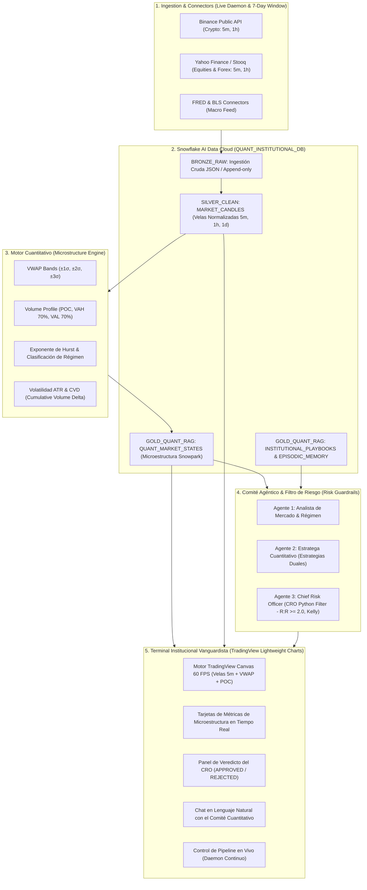

# ⚡ QUANT CORTEX | Snowflake Institutional Multi-Market Terminal & Multi-Agent Committee

> **Sistema Cuantitativo Agéntico e Institucional de Grado Fondos de Cobertura (Hedge Funds)** integrado nativamente con **Snowflake AI Data Cloud**, arquitectura Medallion (**Bronze, Silver, Gold**), cálculo de microestructura de alta frecuencia (**Velas de 5 minutos, VWAP Bands, Volume Profile POC/VAH/VAL, Hurst, CVD**) y orquestación multi-agente con filtro estricto de **Chief Risk Officer (CRO)**.

---

## 🏛️ Arquitectura del Sistema



---

## 🚀 Características Principales

1. **Pipeline Continuo en Vivo (`live_daemon.py`)**:
   - Ingestión automática en segundo plano cada 60 segundos.
   - Ventana deslizante configurable de los **últimos 7 días**.
   - Carga transaccional en Snowflake mediante operaciones idempotentes `MERGE` (Upsert).

2. **Soporte de Velas Japonesas de 5 Minutos (`5m`)**:
   - Descarga paginada de hasta 2,016 velas por activo para análisis intradía de alta resolución.
   - Soportado en Cripto (`BTCUSDT`), Renta Variable (`NVDA`) y Forex (`EURUSD`).

3. **Motor de Microestructura & Medallion en Snowflake**:
   - **Bronze:** Datos crudos en variantes JSON auditables.
   - **Silver:** Velas OHLCV históricas validadas sin duplicados.
   - **Gold:** Estados de mercado enriquecidos con VWAP ($\pm 1, 2, 3\sigma$), Volume Profile (POC, VAH, VAL), Hurst y CVD.

4. **Comité Multi-Agente con Veto del CRO**:
   - **Analista de Régimen:** Evalúa Hurst ($H > 0.55$ Momentum, $H < 0.45$ Reversión a la media).
   - **Estratega Cuantitativo:** Propone órdenes intradía y asignaciones swing plurianuales.
   - **Chief Risk Officer (CRO):** Filtro determinista en código Python que veta cualquier operación que no cumpla con:
     - Ratio Beneficio/Riesgo $R:R \ge 2.0$.
     - Stop Loss calculado como múltiplo de la volatilidad real (ATR).
     - Asignación de capital acotada por el Criterio de Kelly Fraccionado ($1/4$ Kelly).

5. **Terminal Web Interactivo (`app.py`)**:
   - Integración nativa con el motor oficial **TradingView Lightweight Charts™ (HTML5 Canvas 2D a 60 FPS)**.
   - Navegación idéntica a TradingView: zoom suave con la rueda del ratón, arrastre elástico vertical del eje de precios (*price scale drag*), paneo horizontal fluido y auto-escala del eje Y en tiempo real.
   - Marcadores institucionales nativos: VWAP en morado y Point of Control (POC) en dorado con etiquetas de precio automáticas en el eje vertical.
   - Histograma de volumen semitransparente integrado en el 18% inferior sin romper el plano visual.
   - HUD dinámico en cabecera con lectura en vivo de OHLC y variación porcentual.
   - Explorador de datos Medallion en vivo directamente contra Snowflake.
   - Chat interactivo con el comité.

---

## 🛠️ Instalación y Puesta en Marcha

### Prerrequisitos
- Python 3.10+ (probado en Python 3.14).
- Cuenta activa en **Snowflake AI Data Cloud** (credenciales configuradas en `.env`).

### 1. Iniciar el Terminal y Pipeline
Simplemente ejecuta el script de lanzamiento:
```bash
./start_terminal.sh
```
O manualmente:
```bash
source .venv/bin/activate
streamlit run app.py --server.port 8501
```
Abre tu navegador en: **`http://localhost:8501`**

### 2. Ejecutar el Pipeline en Segundo Plano (Opcional)
Para correr el pipeline continuo de sincronización de 7 días y 5 minutos sin abrir el navegador:
```bash
source .venv/bin/activate
python -m src.pipeline.live_daemon --interval 60 --days 7 --timeframe 5m
```

---

## 📊 Estructura de Snowflake

- **Base de datos:** `QUANT_INSTITUTIONAL_DB`
- **Esquemas:**
  - `BRONZE_RAW`: `RAW_MARKET_FEED`, `RAW_ORDERBOOK_FEED`, `RAW_MACRO_FEED`, `RAW_NEWS_FEED`.
  - `SILVER_CLEAN`: `MARKET_CANDLES`.
  - `GOLD_QUANT_RAG`: `QUANT_MARKET_STATES`, `INSTITUTIONAL_PLAYBOOKS`, `EPISODIC_MEMORY_STATES`.
- **Warehouses:**
  - `INGEST_WH` (Talla XSMALL, Auto-suspend 60s).
  - `QUANT_RAG_WH` (Talla SMALL, Auto-suspend 120s).
